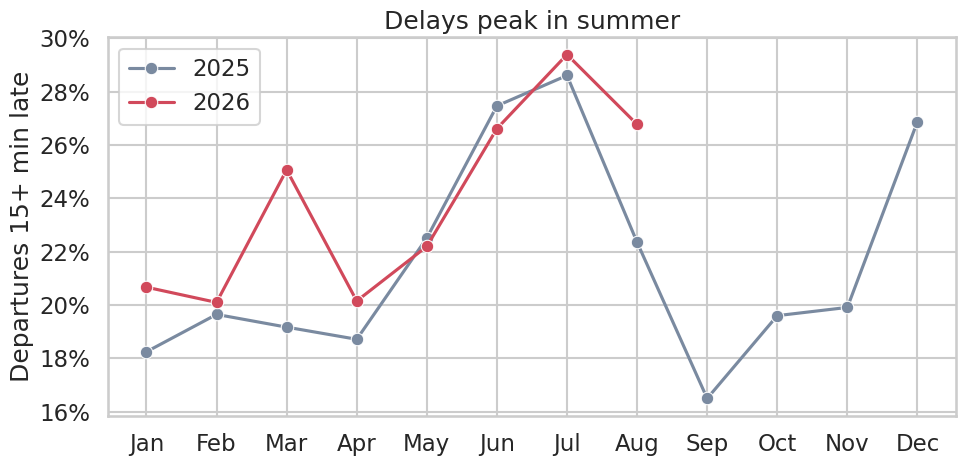
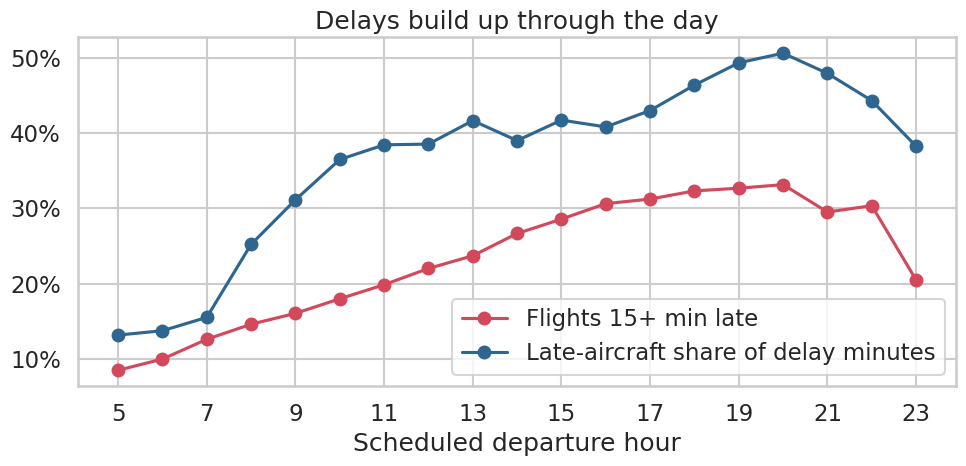
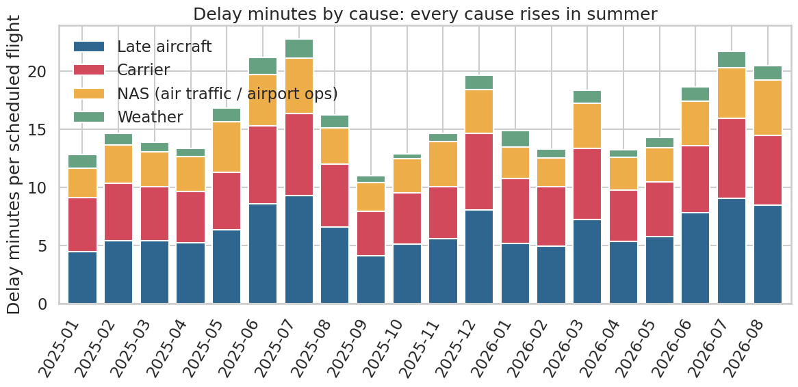
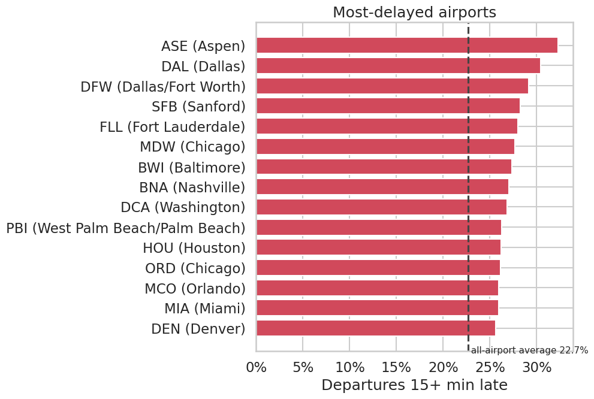
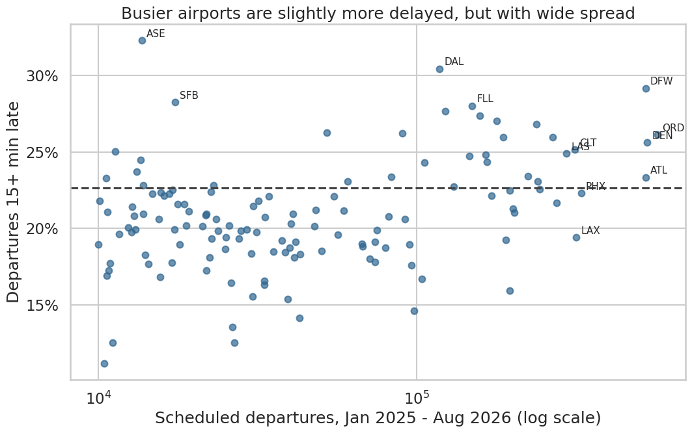
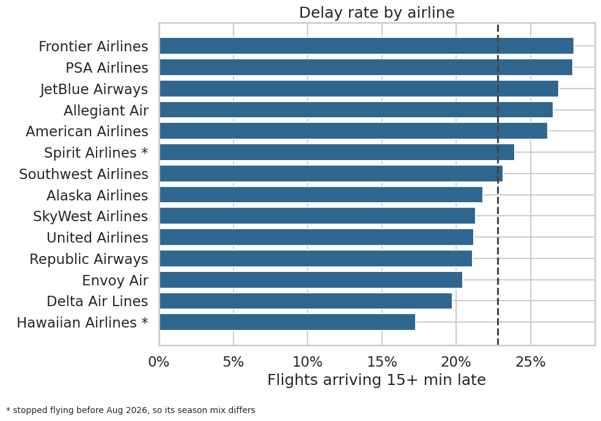
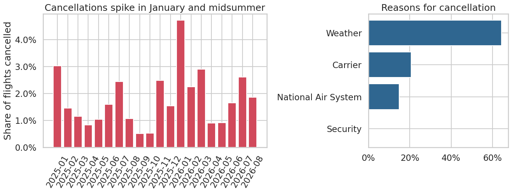
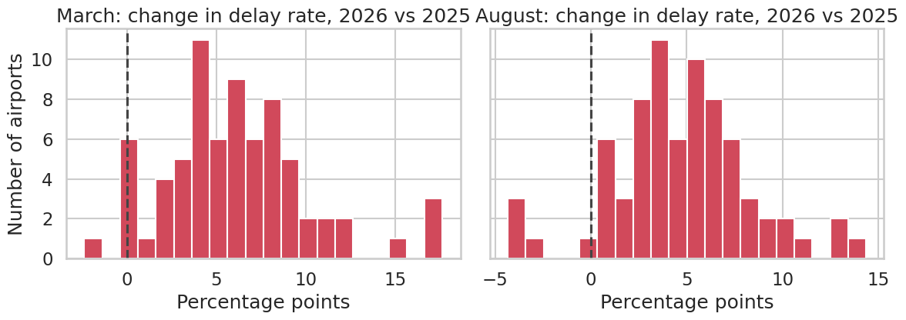
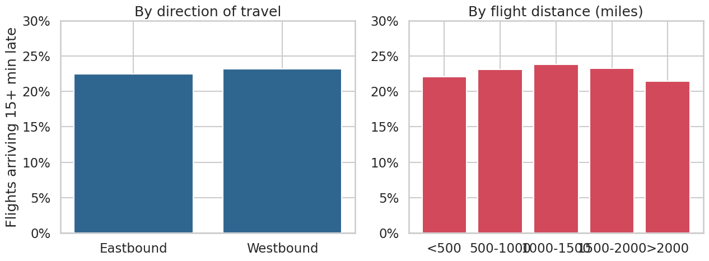

# U.S. Flight Delay Analysis

I analyzed U.S. flight data from January 2025 to August 2026 to find out **when, where and why flights get delayed**. I cleaned and explored the data with SQL (BigQuery) and made the charts with Python.

A flight counts as delayed if it is 15 or more minutes late.

## What I found

- **Delays are a domino effect, not a crowding problem.** The 7am hour has the most flights of any hour (36,850 in the sample), yet only 12.6% are late. By 8pm, 33.2% are, and 50.6% of delay minutes come from an earlier flight running late.
- **Weather barely shows up in delays, but it drives cancellations.** Weather is only 6.4% of delay minutes, while late aircraft (39.6%) and the airlines themselves (32.7%) make up 72.3%. Yet weather is behind 64.4% of cancellations.
- **Delays and cancellations peak in different seasons.** Delays peak in June and July (26.6% to 29.4% of departures late), while cancellations peak in January (4.71% in 2026, 3.02% in 2025) and rise again in July (2.45% in 2025, 2.62% in 2026). The January spike fits winter weather, and the cancellation reasons agree: weather accounts for 64.4% of cancellations.
- **2026 got worse, and not because of one bad storm or airport.** March 2026 had a 25.1% delay rate versus 19.2% in March 2025, and 69 of 72 large airports got worse. In August the rate rose from 22.4% to 26.8%, and 70 of 74 airports got worse.
- **A typical flight arrives early, but 22.8% of flights arrive 15+ minutes late.** Every airline's median flight lands early, so delays come from a long tail of badly late flights.
- **Who you fly with matters.** Frontier (27.9%) and PSA (27.9%) flights are late 1.41 times as often as Delta's (19.8%). The most delayed airport, Aspen (32.3%), handles only 13,694 flights, versus 573,580 at Chicago O'Hare (26.1%).

## Charts

### Delays by month


### Delays by time of day


### Causes of delay


### Most delayed airports


Busier airports tend to be somewhat more delayed, but not always:



### Delays by airline


*Spirit and Hawaiian stopped flying partway through the data, so they aren't directly comparable.*

### Cancellations


### 2026 vs 2025: was it a few airports or everywhere?
Each bar group shows how many airports changed their delay rate by that amount. Almost all moved to the right (worse).



### Direction and distance
These made only a small difference (a few percentage points at most).



## The data

Four tables: **airlines**, **airports**, **daily airport statistics** (about 200,000 rows) and a **500,000-flight sample**.

Source: https://www.kaggle.com/datasets/samuelpombourcq/us-flight-delays-and-cancellations-2025-2026

## How I cleaned it

The cleaning scripts are in `sql/cleaning_scripts/`. The main decisions:

- **Cancelled flights have no delay time, so I left those empty instead of filling in 0.** Filling 0 would make cancelled flights look on time and make average delays look better than they are.
- **Delay causes that were empty became 0**, since a cause is only recorded when a flight is late.
- **Airport codes DJT and PBI are the same airport**, so I merged them.
- **Split the city and state** that were stored together (like "Chicago, IL").
- **Checked that the 500,000-flight sample matches the full data** (for example, each month's share of flights was within 0.1 percentage points).

## Limitations

- This shows patterns, not proof of cause. I can say which airlines are late more often, but not why.
- The flight-level results come from a sample, not every flight.

## Files

```
sql/cleaning_scripts/   scripts that clean each table
sql/validation.sql      checks that the data and sample look right
sql/analysis.sql        the queries behind the findings
notebook/               the Python notebook with the charts
figures/                the chart images
data/raw_tables         the original CSV files
data/cleaned_tables     the cleaned CSV files
```

**Tools:** BigQuery SQL, Python (pandas, matplotlib, seaborn), Google Colab.
